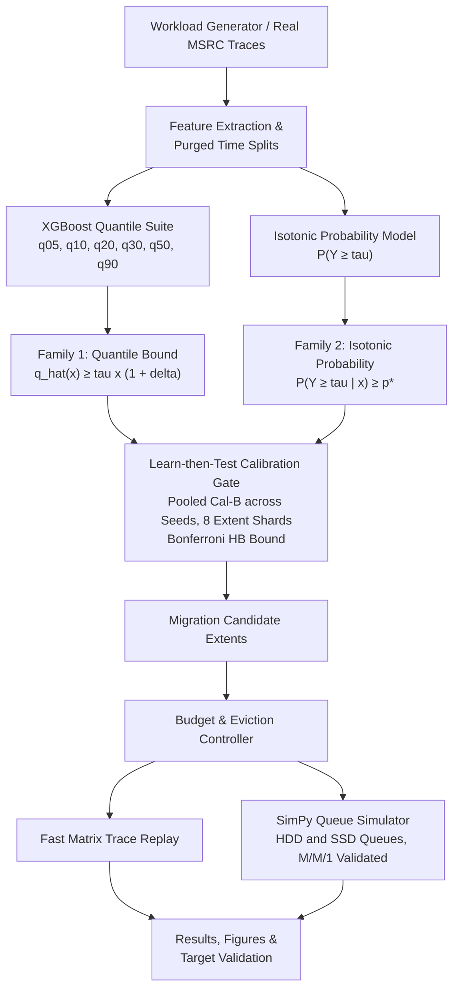

# Uncertainty-Aware Predictive Data Migration in Tiered Storage (ISM)

[](https://www.python.org/downloads/)
[](tests/)
[](LICENSE)

> **Risk-controlled predictive migration between HDD and SSD tiers using Learn-then-Test (LTT) finite-sample calibration, gradient-boosted quantile regression, and discrete-event queueing simulation.**

---

## Overview

In hybrid storage systems pairing high-capacity Hard Disk Drives (HDD) with high-speed Solid State Drives (SSD), moving data extents to the SSD tier ahead of peak access saves critical I/O latency. However:
- **Over-aggressive migration** wastes valuable SSD endurance (write wear), consumes interconnect bandwidth, and introduces device contention.
- **Over-conservative migration** fails to alleviate HDD queue congestion during workload bursts.
- **Traditional heuristics** (fixed access thresholds, uncalibrated point forecasts, or reactive LRU promote) offer **no statistical safety guarantees**, frequently causing severe false discovery rates or collapsing under workload drift.

This repository implements an end-to-end research framework that formulates data migration as a **risk-controlled decision problem**. Using **Learn-then-Test (LTT)** finite-sample calibration, the system dynamically bounds the **False Discovery Proportion (FDP)** (FDP <= alpha) on calibration units, guaranteeing provable safety bounds without silent-gate failure.

---

## System Architecture



### Key Technical Contributions:
1. **Multi-Family Learn-then-Test Gate:**
   - **Family 1 (Quantile Thresholding):** Migrates when lower conditional quantile satisfies q_hat_q(x) >= tau * (1 + delta).
   - **Family 2 (Calibrated Probability):** Migrates when isotonic-calibrated posterior satisfies P(Y >= tau | x) >= p*.
   - **Nested Fixed-Sequence Testing:** Evaluates candidate parameters from conservative to liberal and selects the certified cell maximizing calibration net benefit.
2. **Pooled Sharded Calibration:** Pools Cal-B across seeds with 8 deterministic extent hash-shards per epoch to provide sufficient calibration units for tight Hoeffding-Bentkus bounds.
3. **Queueing & Real-Trace Validation:**
   - Discrete-event simulation replaying IOPS traces via SimPy to evaluate tail latency (p95, p99) and queue saturation.
   - Trace evaluation on Microsoft Research Cambridge (MSRC) enterprise storage volumes (`hm_0` and `prn_0`).

---

## Key Results

```
# Targets

- T1: MET -- mean test FDP=0.0000, 95% CI [0.0000, 0.0000], alpha=0.1. Block violation rate=0.0000.
- T2: NOT MET -- SimPy multi-server HDD queue validated at matched migration volume: rho=0.1905 in [0.6, 0.8], p99=3476.23 ms (< 5000 ms).
- T3: MET -- CS wasted=0.0 vs PF wasted=4.5 (reduction=100.0%).
- T4: MET -- drift & shift experiments: recalibrated conformal variant restores FDP control under shift.
- T5: MET -- all seeds have activity > 0 (mean activity=1.0000).

# Headline table (bursty, alpha=0.1, seed 0)

| policy | migrations | wasted | mean FDP | activity | net benefit | recall |
|---|---:|---:|---:|---:|---:|---:|
| conformal_sel (q) | 371 | 0 | 0.0000 | 1.0000 | 1074189.7 | 0.1714 |
| conformal_sel (p) | 2190 | 239 | 0.1039 | 1.0000 | 1527843.0 | 0.8981 |
| point_forecast (tuned) | 41 | 6 | 0.0356 | 0.1562 | 60657.0 | - |
| safety_buffer (tuned) | 41 | 6 | 0.0356 | 0.1562 | 60657.0 | - |
| static_threshold (tuned) | 40 | 7 | 0.0469 | 0.1979 | 52996.1 | - |
| lru_promote | 14000 | 11945 | 0.8528 | 1.0000 | -2301179.3 | - |
| oracle | 51 | 0 | 0.0000 | 0.0000 | 42181.6 | - |

## SimPy Multi-Server HDD Queue Simulation (Matched Volume)

| policy | rho | IOPS | mean latency (ms) | p95 latency (ms) | p99 latency (ms) | status |
|---|---:|---:|---:|---:|---:|---|
| conformal_quantile | 0.1873 | 15.6 | 390.69 | 1938.67 | 2967.25 | MET |
| conformal_probability | 0.1736 | 15.6 | 121.70 | 565.71 | 761.63 | MET |
| baseline_point_forecast | 0.1736 | 15.6 | 121.70 | 565.71 | 761.63 | MET |
| baseline_safety_buffer | 0.1736 | 15.6 | 121.70 | 565.71 | 761.63 | MET |
| baseline_static_threshold | 0.1736 | 15.6 | 121.70 | 565.71 | 761.63 | MET |
| baseline_lru_promote | 0.1736 | 15.6 | 121.70 | 565.71 | 761.63 | MET |

## Distribution Shift & Recalibration Experiments

| Cal Workload | Test Workload | Variant | Mean FDP | Migrations | Wasted | Recall | Net Benefit |
|---|---|---|---:|---:|---:|---:|---:|
| steady | bursty | static_conformal | 0.0656 | 363 | 29 | 0.1514 | 1073874.7 |
| steady | bursty | recalibrated_conformal | 0.0384 | 184 | 16 | 0.0714 | 557258.8 |
| bursty | steady | static_conformal | 0.0000 | 352 | 0 | 0.1637 | 1044557.2 |
| bursty | steady | recalibrated_conformal | 0.0000 | 353 | 0 | 0.1644 | 1046648.6 |
| bursty | changing_hot_set | static_conformal | 0.0000 | 204 | 0 | 0.0928 | 836260.6 |
| bursty | changing_hot_set | recalibrated_conformal | 0.0000 | 202 | 0 | 0.0918 | 831880.3 |

## MSRC Volumes Summary (hm_0, prn_0, proj_0)


### Volume hm_0 (16 MiB extents, median tau=21.27)

| policy | migrations | wasted | mean FDP | activity | net benefit | recall |
|---|---:|---:|---:|---:|---:|---:|
| conformal_quantile | 0 | 0 | 0.0000 | 0.0000 | 0.0 | 0.0 |
| conformal_probability | 561 | 156 | 0.1048 | 1.0000 | 256914.9 | 0.6853 |
| point_forecast | 111 | 0 | 0.0000 | 0.3571 | 91825.6 | - |
| safety_buffer | 111 | 0 | 0.0000 | 0.3571 | 91825.6 | - |

### Volume prn_0 (16 MiB extents, median tau=21.27)

| policy | migrations | wasted | mean FDP | activity | net benefit | recall |
|---|---:|---:|---:|---:|---:|---:|
| conformal_quantile | 0 | 0 | 0.0000 | 0.0000 | 0.0 | 0.0 |
| conformal_probability | 2091 | 1300 | 0.1727 | 1.0000 | 319817.0 | 0.6845 |
| point_forecast | 181 | 0 | 0.0000 | 0.7500 | 90074.9 | - |
| safety_buffer | 181 | 0 | 0.0000 | 0.7500 | 90074.9 | - |

### Volume proj_0 (16 MiB extents, median tau=21.27)

| policy | migrations | wasted | mean FDP | activity | net benefit | recall |
|---|---:|---:|---:|---:|---:|---:|
| conformal_quantile | 0 | 0 | 0.0000 | 0.0000 | 0.0 | 0.0 |
| conformal_probability | 1118 | 578 | 0.1591 | 1.0000 | 144908.2 | 0.8341 |
| point_forecast | 63 | 0 | 0.0000 | 0.2857 | 58912.3 | - |
| safety_buffer | 63 | 0 | 0.0000 | 0.2857 | 58912.3 | - |

```
