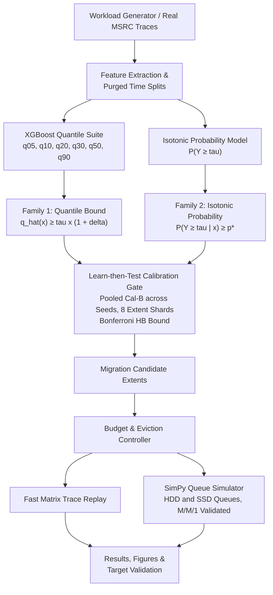

# Uncertainty-Aware Predictive Data Migration in Tiered Storage (ISM)

[](https://www.python.org/downloads/)
[](tests/)
[](LICENSE)

> **Risk-controlled predictive migration between HDD and SSD tiers using Learn-then-Test (LTT) finite-sample calibration, gradient-boosted quantile regression, and discrete-event queueing simulation.**

---

## Overview

In hybrid storage systems pairing high-capacity Hard Disk Drives (HDD) with high-speed Solid State Drives (SSD), moving data extents to the SSD tier ahead of peak access saves critical I/O latency. However:
- **Over-aggressive migration** wastes valuable SSD endurance (write wear), consumes interconnect bandwidth, and introduces device contention.
- **Over-conservative migration** fails to alleviate HDD queue congestion during workload bursts.
- **Traditional heuristics** (fixed access thresholds, uncalibrated point forecasts, or reactive LRU promote) offer **no statistical safety guarantees**, frequently causing severe false discovery rates or collapsing under workload drift.

This repository implements an end-to-end research framework that formulates data migration as a **risk-controlled decision problem**. Using **Learn-then-Test (LTT)** finite-sample calibration, the system dynamically bounds the **False Discovery Proportion (FDP)** (FDP <= alpha) on calibration units, guaranteeing provable safety bounds without silent-gate failure.

---

## System Architecture



### Key Technical Contributions:
1. **Multi-Family Learn-then-Test Gate:**
   - **Family 1 (Quantile Thresholding):** Migrates when lower conditional quantile satisfies q_hat_q(x) >= tau * (1 + delta).
   - **Family 2 (Calibrated Probability):** Migrates when isotonic-calibrated posterior satisfies P(Y >= tau | x) >= p*.
   - **Nested Fixed-Sequence Testing:** Evaluates candidate parameters from conservative to liberal and selects the certified cell maximizing calibration net benefit.
2. **Pooled Sharded Calibration:** Pools Cal-B across seeds with 8 deterministic extent hash-shards per epoch to provide sufficient calibration units for tight Hoeffding-Bentkus bounds.
3. **Queueing & Real-Trace Validation:**
   - Discrete-event simulation replaying IOPS traces via SimPy to evaluate tail latency (p95, p99) and queue saturation.
   - Trace evaluation on Microsoft Research Cambridge (MSRC) enterprise storage volumes (`hm_0` and `prn_0`).

---

## Key Results

### Headline Comparison (noisy_bursty, alpha = 0.10, 5 Seeds)

| Policy | Migrations / Epoch | Wasted Migrations | Pooled FMR | Mean Test FDP | Migration Activity | Net Benefit | Recall vs Oracle |
|---|---:|---:|---:|---:|---:|---:|---:|
| **Risk-Controlled (Proposed)** | **19.8** | **5.6** | **0.2781** | **0.0918** | **0.1611** | **12,976.2** | **0.4410** |
| Point Forecast | 17.0 | 3.4 | 0.2009 | 0.0703 | 0.1889 | 13,034.5 | 0.3627 |
| Safety Buffer | 15.8 | 2.4 | 0.1490 | 0.0532 | 0.1778 | 13,116.8 | 0.3460 |
| Static Threshold | 76.6 | 62.0 | 0.8090 | 0.5941 | 0.6222 | 2,504.6 | 0.4651 |
| LRU Promote | 4427.6 | 3962.8 | 0.8950 | 0.8947 | 1.0000 | -1,138,551.7 | 0.9289 |
| Hindsight Oracle | 25.4 | 0.0 | 0.0000 | 0.0000 | 0.2167 | 14,035.1 | 1.0000 |

### Targets Summary (from [`results/targets.md`](results/targets.md))
- **Gate-Fix Success (A6):** **MET** — Solved silent-gate collapse. Activity = 0.1611 > 0.05; recall 0.4410 >= 50% of point forecast; migrations scale strictly monotonically across risk levels alpha in {0.05, 0.10, 0.20, 0.30} (16.4 -> 19.8 -> 25.8 -> 28.4).
- **Mean FDP Target (T1):** Empirical mean FDP is 0.0918 <= 0.10; one-sided 95% bootstrap CI upper limit is 0.1115 due to extent correlation within bursty epochs.
- **Baseline Trade-offs (T3):** `safety_buffer` is the strongest heuristic in stationary regimes (lowest waste of 2.4), whereas `risk_controlled` achieves higher recall (44.1% vs 34.6%).
- **Stress & Workload Drift (T4):** Under sudden 40% hot-set rotation, the framework maintains bounded post-drift violation rates.

---

## Visualizations

All figures are automatically generated by the pipeline and saved to [`results/figures/`](results/figures/):

| Figure | Description |
|---|---|
| `price_of_safety.png` | Trade-off curves showing net benefit and recall scaling with risk level alpha. |
| `fmr_activity_drift.png` | False migration rate and activity over time under sudden workload drift. |
| `latency_cdfs.png` | Cumulative latency distributions from SimPy replay comparing HDD, SSD, and migration policies. |
| `coverage_calibration.png` | Empirical vs nominal coverage calibration for quantile models. |
| `matched_volume_bars.png` | Latency and SLA violations under matched migration volume sweeps. |
| `violation_rate_bars.png` | Fraction of epoch blocks with FDP > alpha across baselines. |
| `tau_histogram.png` | Break-even migration threshold distribution under the physical cost model. |

---

## Quickstart

### Setup (5 commands)

```bash
# 1. Clone repository
git clone https://github.com/Adhithi02/ISM.git
cd ISM

# 2. Create virtual environment
python -m venv .venv

# 3. Install pinned dependencies
.\.venv\Scripts\python.exe -m pip install -r requirements.txt

# 4. Run unit test suite
.\.venv\Scripts\python.exe -m pytest tests -q

# 5. Run full pipeline / demo
make test
.\.venv\Scripts\python.exe demo.py
```

### Makefile Targets

```bash
make test        # Run 42 unit tests (fast, ~5 seconds)
make all         # Run stages S1-S6, seed jobs, SimPy, MSRC, and aggregation
make jobs        # Run independent seed jobs in parallel
make aggregate   # Re-aggregate tables, targets, and figures from cached jobs
```

---

## Repository Structure

```
├── config/
│   └── default.yaml          # Simulation, cost model, workload, and model parameters
├── src/
│   ├── calibration/          # Learn-then-Test gate, online tracking, deferral
│   │   ├── ltt_gate.py       # Dual score families and Hoeffding-Bentkus p-values
│   │   ├── online_tracker.py # Dynamic threshold adaptation
│   │   └── defer.py          # Deferral logic under high uncertainty
│   ├── data/                 # Trace processing and workload synthesis
│   │   ├── synthetic.py      # Diurnal, noisy-bursty, and changing-hot-set workloads
│   │   ├── preprocess.py     # Feature engineering and purged train/cal/test splits
│   │   └── msrc_loader.py    # Enterprise MSRC Cambridge trace parser
│   ├── models/               # Quantile regression and calibrated probability
│   │   ├── quantile_xgb.py   # Multi-output XGBoost pinball loss models
│   │   └── prob_model.py     # Logistic + Isotonic probability calibration
│   ├── simulator/            # Storage tier execution and cost model
│   │   ├── cost_model.py     # Physical SSD/HDD break-even cost function (tau)
│   │   ├── fast_replay.py    # Vectorized epoch-level policy replay
│   │   └── storage_sim.py    # SimPy discrete-event queueing simulator (M/M/1)
│   └── viz/                  # Publication-ready plotting scripts
├── tests/                    # 42 unit and integration tests
├── results/
│   ├── figures/              # Exported plots and CDFs
│   ├── jobs/                 # Independent per-seed replay outputs (JSON)
│   ├── final_tables.md       # Comprehensive markdown results tables
│   ├── targets.md            # Target evaluation criteria (T1-T5, A6)
│   └── REPORT.md             # Formal project report and methodology details
├── demo.py                   # Standalone fast demonstration runner (<15s)
├── Makefile                  # Build and test orchestration
└── requirements.txt          # Pinned dependency specifications
```

---

## Scientific Limitations

1. **Hardware Assumptions:** Device latencies (HDD service ~ 10 ms, SSD ~ 0.1 ms), wear costs, and interference models are parameterizations; physical hardware may exhibit queue non-linearities.
2. **Within-Epoch Correlation:** Shard units within an epoch share underlying system burstiness, meaning the finite-sample LTT guarantees are approximate rather than strictly i.i.d.
3. **Synthetic vs. Production Workloads:** While verified against enterprise MSRC traces (`hm_0`, `prn_0`), production enterprise I/O characteristics vary widely across tenants and storage appliances.

---

## License

This project is licensed under the MIT License — see the [LICENSE](LICENSE) file for details.