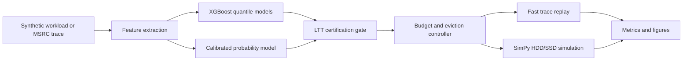

# Uncertainty-Aware Predictive Data Migration in Tiered Storage

[](https://www.python.org/downloads/)
[](tests/)
[](LICENSE)

ISM is a research framework for deciding when to migrate data extents between HDD and SSD storage tiers. It combines:

- Forecast models for future extent demand
- Quantile and calibrated-probability risk scores
- Learn-then-Test (LTT) calibration for limiting false migrations
- Budget-aware migration and eviction policies
- Fast trace replay and SimPy queueing simulation
- Synthetic workloads and Microsoft Research Cambridge (MSRC) traces

The goal is to migrate useful extents before an access burst without wasting limited SSD capacity on data that does not need to migrate.

## How It Works



### Risk-Controlled Decision Families

1. **Quantile family**  
   Migrates when a lower quantile forecast meets a configured threshold and safety margin.

2. **Probability family**  
   Migrates when an isotonic-calibrated probability exceeds a probability threshold.

The LTT gate evaluates candidate parameters, applies Bonferroni correction across the two score families, and selects a certified configuration based on calibration benefit.

## Key Features

- Purged train, calibration-A, calibration-B, and test splits
- Deterministic 8-shard pooling of calibration units
- Hoeffding-Bentkus certificate support
- Nested fixed-sequence family selection
- Distribution-shift recalibration experiments
- Online threshold tracking and deferral
- HDD, SSD, LRU, static-threshold, safety-buffer, point-forecast, and oracle policies
- Fast matrix replay and discrete-event queue simulation
- Synthetic, real-trace, stress, and algorithm-benchmark experiments

## Repository Structure

```text
config/
  default.yaml                 Master experiment configuration

src/
  calibration/                 LTT, conformal selection, deferral, online tracking
  data/                        Synthetic workloads and MSRC trace loading
  experiment/                  Experiment runners, metrics, statistics, benchmarks
  models/                      Quantile and probability models
  selection/                   Migration budget selection
  simulator/                   Cost model, replay, eviction, and queue simulation
  viz/                         Plot and visualization helpers

tests/                         48 unit and integration tests
results/
  jobs/                        Per-seed and scenario experiment outputs
  figures/                     Generated result plots
  targets.md                   Target and headline-result summary
  final_tables.md              Aggregated experimental tables
  REPORT.md                    Reproducibility-oriented project report
  paper_benchmark_report.md    Cross-algorithm benchmark report

demo.py                        Display cached demo results
aggregate_final.py             Aggregate jobs and regenerate reports
run_algorithm_benchmark.py     Cross-algorithm benchmark
run_credible.py                Core synthetic, shift, and MSRC experiments
Makefile                     Windows and Python 3.12 experiment commands
requirements.txt               Pinned Python dependencies
```

## Current Experimental Results

Detailed outputs are available in [results/targets.md](results/targets.md), [results/final_tables.md](results/final_tables.md), and [results/paper_benchmark_report.md](results/paper_benchmark_report.md).

For the noisy-bursty workload at `alpha = 0.10`, the main static replay comparison reports:

| Policy | Migrations | Wasted | Mean FDP | Activity | Net Benefit |
|---|---:|---:|---:|---:|---:|
| Risk controlled | 19.8 | 5.6 | 0.0918 | 0.1611 | 12,976.2 |
| Point forecast | 17.0 | 3.4 | 0.0703 | 0.1889 | 13,034.5 |
| Safety buffer | 15.8 | 2.4 | 0.0532 | 0.1778 | 13,116.8 |
| Static threshold | 76.6 | 62.0 | 0.5941 | 0.6222 | 2,504.6 |
| LRU promote | 4,427.6 | 3,962.8 | 0.8947 | 1.0000 | -1,138,551.7 |
| Hindsight oracle | 25.4 | 0.0 | 0.0000 | 0.2167 | 14,035.1 |

The checked-in `results/targets.md` also records:

- Gate-fix activity and recall criteria: **MET**
- Mean-FDP target: **NOT MET** by a block-level criterion
- T3 waste comparison: **MET**
- T4 shift and online-tracker stress comparison: **MET**
- T5 migration-activity requirement: **MET**
- T2 queue-validation target: **MET** in the current stored result summary

These are empirical results, not a claim of strict production hardware guarantees.

## Setup

The project is configured for Python 3.12 on Windows.

```powershell
python -m venv .venv
.\.venv\Scripts\python.exe -m pip install --upgrade pip
.\.venv\Scripts\python.exe -m pip install -r requirements.txt
```

## Run Tests

```powershell
.\.venv\Scripts\python.exe -m pytest tests -q
```

The test suite currently contains 48 tests covering calibration validity, conformal selection, purge gaps and leakage, model coverage, deferral, migration budgets, and storage simulation.

## Run the Project

Display cached demonstration results and generate key figures:

```powershell
.\.venv\Scripts\python.exe demo.py
```

Run the main gate sanity check:

```powershell
.\.venv\Scripts\python.exe regime_gate.py
```

Run the full aggregate pipeline:

```powershell
make all
make aggregate
```

Makefile targets include:

```text
make test        Run the test suite
make all         Run stages S1-S6, seed jobs, SimPy, MSRC, and aggregation
make jobs        Run independent seed jobs
make aggregate   Rebuild tables and reports from cached job outputs
make s1 ... s7   Run individual experiment stages
make final       Run the bounded final pass
make clean       Remove generated JSON, CSV, and plot files
```

## Reproducing Results

```powershell
.\.venv\Scripts\python.exe run_credible.py
.\.venv\Scripts\python.exe launch_jobs.py 5
.\.venv\Scripts\python.exe run_simpy_jobs.py --seeds 3
.\.venv\Scripts\python.exe run_msrc_jobs.py
.\.venv\Scripts\python.exe aggregate_final.py
.\.venv\Scripts\python.exe demo.py
```

The reproducibility inputs are [config/default.yaml](config/default.yaml) and the scenario/seed files under [results/jobs/](results/jobs/). Re-running a pipeline may change numerical values due to hardware performance or dependency behavior.

## Limitations

- LTT certificates assume calibration units are exchangeable; correlated extents within an epoch can weaken that guarantee.
- Synthetic workloads do not reproduce every production storage-access pattern.
- MSRC trace coverage is limited to the included volumes.
- Device latencies, wear, bandwidth, interference, and SSD write-back behavior are modeled assumptions.
- The online tracker is a heuristic adaptation mechanism rather than a replacement for periodic recalibration.
- Aggregated FDR/FDP statistics must be interpreted with epoch-level correlations and finite-sample uncertainty.

## License

This project is licensed under the MIT License. See [LICENSE](LICENSE).
